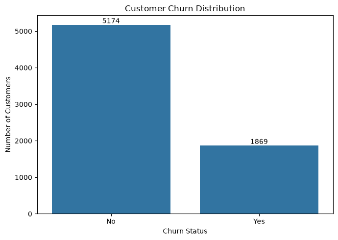
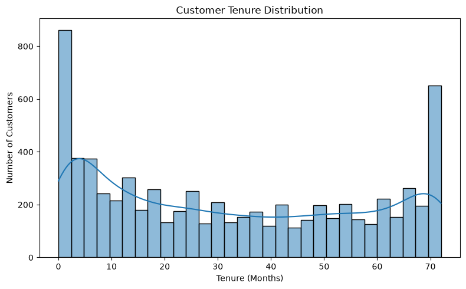
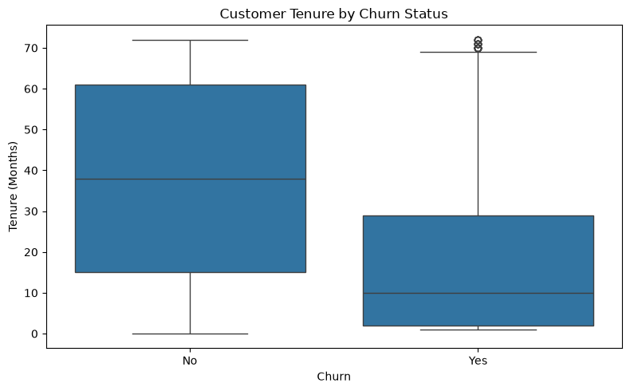
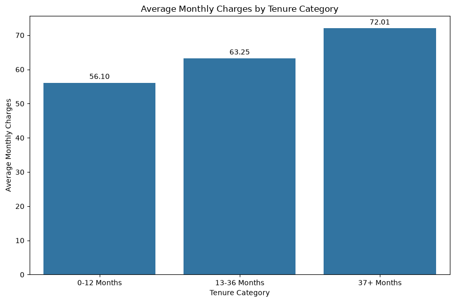
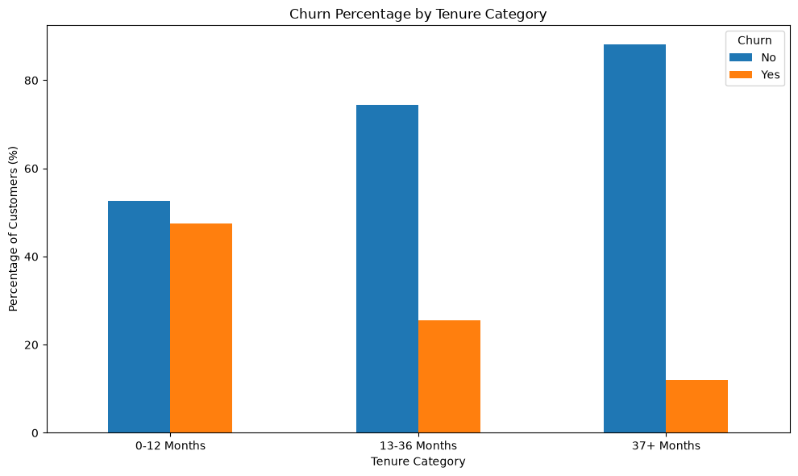

# Telco Customer Churn Analysis

## Project Overview

This project analyses the Telco Customer Churn dataset using Python to understand customer retention, identify patterns associated with churn, and examine how customer tenure, monthly charges, and customer behaviour relate to customer decisions to leave a telecommunications company.

The project applies data-cleaning techniques, exploratory data analysis, aggregation with Pandas, and visualisation with Matplotlib and Seaborn to turn customer data into meaningful business observations and recommendations.

## Table of Contents

- [Key Business Insights](#key-business-insights)
- [Overall Churn Performance](#1-overall-churn-performance)
- [Customer Tenure Distribution](#2-customer-tenure-distribution)
- [Customer Tenure by Churn Status](#3-customer-tenure-by-churn-status)
- [Average Monthly Charges by Tenure Category](#4-average-monthly-charges-by-tenure-category)
- [Churn Rate by Tenure Category](#5-churn-rate-by-tenure-category)
- [Key Business Recommendations](#key-business-recommendations)
- [Assumptions and Limitations](#assumptions-and-limitations)
- [How to View the Analysis](#how-to-view-the-analysis)
- [Tools and Technologies](#tools-and-technologies)
- [Repository Structure](#repository-structure)
- [Author](#author)
- [About the Project](#about-the-project)

## Key Business Insights

### 1. Overall Churn Performance

| Metric | Result |
|---|---:|
| Total customers | 7,043 |
| Churned customers | 1,869 |
| Retained customers | 5,174 |
| Overall churn rate | 26.54% |
| Customer retention rate | 73.46% |
| Average customer tenure | 32.37 months |
| Average monthly charges | $64.76 |
| Average total charges | $2,283.30 |

The dataset contains 7,043 customers, of whom 1,869 discontinued their subscriptions.

The overall churn rate of 26.54% indicates that more than one in every four customers left the company.

**Code:**

```python
churn_counts = df['churn'].value_counts()

churn_counts.plot(
    kind='bar',
    figsize=(8, 5),
    color=['steelblue', 'salmon']
)

plt.title('Customer Churn Distribution')
plt.xlabel('Churn')
plt.ylabel('Number of Customers')
plt.xticks(rotation=0)
plt.tight_layout()
plt.show()
```

**Preview:**



### 2. Customer Tenure Distribution

The analysis examined the distribution of customer tenure to understand how long customers had maintained their relationship with the telecommunications company.

The dataset contains customers at different stages of their relationship with the company, ranging from newly acquired customers to long-term subscribers.

Understanding tenure distribution helps identify customer lifecycle patterns and provides context for examining customer retention.

**Code:**

```python
plt.figure(figsize=(8, 5))

sns.histplot(
    df['tenure'],
    bins=30,
    kde=True
)

plt.title('Customer Tenure Distribution')
plt.xlabel('Tenure (Months)')
plt.ylabel('Number of Customers')
plt.tight_layout()
plt.show()
```

**Preview:**



### 3. Customer Tenure by Churn Status

| Customer Status | Average Tenure |
|---|---:|
| Retained Customers | 37.57 months |
| Churned Customers | 17.98 months |

Customers who churned had an average tenure of approximately 18 months, compared with approximately 38 months for customers who remained.

The difference suggests that customer retention is particularly important during the early stages of the customer relationship.

**Code:**

```python
plt.figure(figsize=(8, 5))

sns.boxplot(
    data=df,
    x='churn',
    y='tenure'
)

plt.title('Customer Tenure by Churn Status')
plt.xlabel('Churn')
plt.ylabel('Tenure (Months)')
plt.tight_layout()
plt.show()
```

**Preview:**



### 4. Average Monthly Charges by Tenure Category

| Tenure Category | Average Monthly Charges |
|---|---:|
| 0–12 Months | $56.10 |
| 13–36 Months | $63.25 |
| 37+ Months | $72.01 |

Average monthly charges increase across the tenure categories.

Customers who have stayed for 37 months or longer have the highest average monthly charges, while customers within their first 12 months have the lowest.

**Code:**

```python
monthly_charges_by_tenure = df.groupby(
    'tenure_category'
)['monthlycharges'].mean()

monthly_charges_by_tenure.plot(
    kind='bar',
    figsize=(8, 5),
    color='steelblue'
)

plt.title('Average Monthly Charges by Tenure Category')
plt.xlabel('Tenure Category')
plt.ylabel('Average Monthly Charges')
plt.xticks(rotation=0)
plt.tight_layout()
plt.show()
```

**Preview:**



### 5. Churn Rate by Tenure Category

| Tenure Category | Retained (%) | Churned (%) |
|---|---:|---:|
| 0–12 Months | 52.56% | 47.44% |
| 13–36 Months | 74.46% | 25.54% |
| 37+ Months | 88.07% | 11.93% |

Customers within their first 12 months recorded the highest churn rate at 47.44%.

The churn rate declined to 25.54% among customers with 13–36 months of tenure and fell further to 11.93% among customers who had stayed for at least 37 months.

This indicates a clear descriptive relationship between longer customer tenure and lower churn rates.

**Code:**

```python
churn_by_tenure = pd.crosstab(
    df['tenure_category'],
    df['churn'],
    normalize='index'
) * 100

churn_by_tenure.plot(
    kind='bar',
    stacked=True,
    figsize=(8, 5)
)

plt.title('Churn Rate by Tenure Category')
plt.xlabel('Tenure Category')
plt.ylabel('Percentage of Customers')
plt.xticks(rotation=0)
plt.legend(title='Churn')
plt.tight_layout()
plt.show()
```

**Preview:**



## Key Business Recommendations

**Strengthen early customer retention:** Focus on customers within their first 12 months through onboarding support, follow-ups, and targeted retention programmes.

**Monitor customer behaviour:** Use customer tenure and service subscriptions to identify groups that may require additional retention support.

**Review monthly charges:** Investigate whether higher monthly charges are associated with customer dissatisfaction and consider reviewing pricing and service packages.

**Encourage long-term customer relationships:** Explore incentives and service improvements that encourage customers to maintain their subscriptions.

**Improve customer support:** Review the availability and quality of technical support and other customer services as part of a wider retention strategy.

**Monitor churn regularly:** Track churn rates across customer groups over time to identify changes and evaluate the effectiveness of retention initiatives.

## Assumptions and Limitations

The dataset contains 7,043 customer records and 21 original columns.

The original dataset had no duplicate records.

The 11 blank values in the `TotalCharges` column were identified after converting the column from object to numeric data type. They were converted to missing values and were not automatically replaced with estimated values.

The `SeniorCitizen` column is represented as a binary variable, where 1 indicates a senior citizen and 0 indicates otherwise.

Tenure categories were created using the following ranges: 0–12 months, 13–36 months, and 37 months or more.

Churn rates represent the proportion of customers who left within each category, not the proportion of all churned customers belonging to that category.

The analysis is descriptive and identifies associations rather than proving that individual factors cause customer churn.

The findings are based on the available dataset and do not establish the exact reasons behind every customer's decision to leave.

## How to View the Analysis

Clone or download this repository.

Open the project folder in Visual Studio Code or your preferred Python environment.

Ensure Python and the required libraries are installed.

Open and run the analysis notebook.

Review the visualisations in the `images/` folder and the findings presented in this README.

Install the main libraries with:

```bash
pip install pandas numpy matplotlib seaborn jupyter
```

## Tools and Technologies

**Python** — data analysis and scripting.

**Pandas** — data cleaning, grouping, aggregation, and data manipulation.

**NumPy** — numerical operations.

**Matplotlib** — data visualisation.

**Seaborn** — statistical visualisation.

**Jupyter Notebook** — interactive analysis and documentation.

**CSV** — source dataset format.

## Repository Structure

```text
Telco-Customer-Churn-Analysis/
│
├── images/
│   ├── churn_distribution.png
│   ├── tenure_distribution.png
│   ├── tenure_by_churn.png
│   ├── monthly_charges_by_tenure.png
│   └── churn_rate_by_tenure.png
│
├── data/
│   └── Telco_Customer_Churn_Dataset.csv
│
├── README.md
└── Telco_Customer_Churn_EDA.ipynb
```

## Author

**Abdulmuiz Abdulazeez Arikewushola**

Data Analyst | Excel | SQL | Power BI | Python

[LinkedIn](https://www.linkedin.com/in/torshaw) | [E-mail](aatorshaw.@gmail.com)

---

## About the Project

Telco Customer Churn Analysis is a practical data analytics project focused on preparing, exploring, and visualising telecommunications customer data. It demonstrates the use of Python, Pandas, Matplotlib, and Seaborn to examine customer retention patterns, identify groups associated with higher churn, and communicate business observations through clear insights and recommendations.
